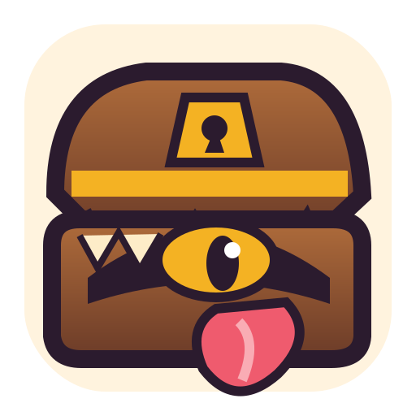

# ChestDrop

**Upload images to [ImgChest](https://imgchest.com/) directly from Firefox.**

Right-click an image, choose **Upload image to ImgChest**, and ChestDrop handles the rest.

[Features](#features) · [Installation](#installation) · [Getting started](#getting-started) · [Settings](#settings) · [Troubleshooting](#troubleshooting)

> [!NOTE]
> **ChestDrop is currently a desktop Firefox extension (Firefox 140 or newer).** Version 0.1.4 is an early development release. The GitHub Actions builds are **unsigned** and intended for temporary testing; they are not permanently installable in standard Firefox until signed by Mozilla. Firefox for Android is not supported.

## Features

- **One-click image uploads:** Right-click almost any image on a website and select **Upload image to ImgChest**.
- **Direct image tabs:** Open an image in its own browser tab and upload it through the ChestDrop toolbar popup.
- **Discord CDN support:** Attempts to retrieve Discord-hosted images, including recovery from an image already visible in Firefox when its original link has expired. Recovery is best-effort, not guaranteed.
- **Control post visibility:** Set the default to **Hidden**, **Public**, or **Secret**.
- **Choose a content rating:** Mark new uploads **SFW** or **NSFW** by default.
- **Pick what happens next:** Open the new post in an active tab, open it in a background tab, or don't open a tab at all.
- **Optional post titles:** Turn filenames into titles automatically.
- **Convenient settings:** Store your ImgChest API token locally, test the connection, and export/import your settings as a JSON backup.
- **Recent upload link:** Reopen your latest ImgChest post from the toolbar popup.

## Installation

### Development build (current distribution)

1. Open the [GitHub Actions build page](https://github.com/BlackShuck89/ChestDrop/actions/workflows/check.yml) and select a successful **Verify and build ChestDrop** run.
2. Under **Artifacts**, download **ChestDrop-unsigned** and extract the `.xpi` from the downloaded ZIP.
3. In Firefox Desktop, open `about:debugging#/runtime/this-firefox`.
4. Select **Load Temporary Add-on…**, then select the extracted `.xpi` file (or `manifest.json` from a downloaded source checkout).

**Important:** Temporary add-ons are removed when Firefox restarts. For normal, persistent installation, ChestDrop must first be signed through Mozilla's add-on signing process. An unsigned XPI generally cannot be installed permanently in standard Firefox.

You can also get the project source from **Code → Download ZIP** on this repository.

## Getting started

1. **Get your ImgChest API token.** Sign in to [ImgChest](https://imgchest.com/), find **Security → Personal Access Tokens**, and create a token. See [ImgChest's API token instructions](https://imgchest.com/docs/api/1.0/general/authorization). Keep the token private.
2. **Open ChestDrop Settings.** Click the ChestDrop mimic icon in Firefox's toolbar and select **Settings**.
3. **Enter the token**, choose your preferred visibility, SFW/NSFW rating, and tab behavior, then select **Save settings**. Your ImgChest username is optional and may help with token testing.
4. **Upload an image.** Right-click an image on a page and choose **Upload image to ImgChest**.

By default, ChestDrop creates a **Hidden, SFW** post and opens the new ImgChest post in a foreground tab.

### Uploading an image opened in its own tab

Open the image URL in Firefox, click the **ChestDrop toolbar icon**, and select **Upload image in current tab**.

## Settings

| Setting | What it does |
| --- | --- |
| API token | Authenticates uploads to your ImgChest account. Stored locally in your Firefox profile. |
| ImgChest username | Optional; helps with the alternate API-token check. |
| After uploading | Open post in foreground (default), background, or not at all. |
| Post visibility | Hidden (default), Public, or Secret. |
| Default content rating | SFW (default) or NSFW. |
| Filename as title | Optionally generate post titles from image filenames. |
| Discord screenshot fallback | Last-resort recovery for a fully visible Discord image when the original can't be downloaded. |
| Export / Import settings | Save and restore a portable JSON settings backup. |

**Your settings are saved locally** and should survive normal in-place updates with the same extension ID. However, **removing a temporary extension can erase its settings**. Before replacing a temporary build, open **Settings → Local settings backup → Export saved settings (.json)**. After reloading the extension, use **Import settings (.json)**.

> [!CAUTION]
> Backups that include your API token store it **in plain text**. Keep those backup files private. You can uncheck **Include my API token in the backup** before exporting.

## Troubleshooting

**“Test API key” reports HTTP 404**

ImgChest may return a 404 for the documented account-check endpoint. This is **not proof that your token is invalid**. Enter your ImgChest username in Settings and try the alternate check, or attempt a normal upload. A successful normal upload confirms that the upload endpoint accepts the token.

**An image from Discord won't upload**

Discord attachment links can expire. ChestDrop first attempts to fetch the original image, then may recover rendered image pixels or (if enabled) a screenshot of a fully visible Discord image. These fallbacks can produce a static or lower-resolution image and **cannot guarantee recovery**. Try opening the image in its own tab before uploading.

**ChestDrop disappears when Firefox closes**

You're using a temporary, unsigned development build. Firefox removes temporary add-ons when it restarts. Permanent installation requires a Mozilla-signed version.

**My settings disappeared after an update**

Replacing a temporary build by removing and reinstalling it may delete local extension data. Export your settings **before** removing the extension and import them after reinstalling. In-place signed updates should retain your settings.

**No new tab appeared after uploading**

Check **Settings → After uploading**. You may have chosen background-tab or no-tab mode. You can also check the most recent upload in the toolbar popup.

## Privacy and permissions

ChestDrop **does not include advertising, analytics, or telemetry**. It stores your token and preferences in Firefox's local extension storage. When you explicitly upload an image, it sends that selected image, your chosen post options, and your API token to ImgChest. Testing the token also contacts the ImgChest API.

ChestDrop requests access to website images so that you can upload images from arbitrary webpages. It does not automatically upload images or monitor your browsing history.

Read the [full privacy notice](PRIVACY.md) for details, including Mozilla's authentication and website-content transmission disclosures.

## Current limitations

- Firefox **Desktop** only; Firefox for Android is not currently supported.
- One image per post; bulk/gallery uploads are not yet implemented.
- Supported image formats: JPEG, PNG, GIF, WebP, BMP, and AVIF. SVG and video uploads are not supported.
- ChestDrop has a **32 MiB per-image safety limit**, independent of any ImgChest server limits.
- Images requiring a website login, restricted URLs, or expired Discord attachments may not be retrievable.
- Browser-image or screenshot recovery may lose the original format, metadata, animation, or resolution.

## Feedback and development

Found a bug or have a feature request? [Open a GitHub issue](https://github.com/BlackShuck89/ChestDrop/issues). For development builds and automated test results, see [GitHub Actions](https://github.com/BlackShuck89/ChestDrop/actions).

ChestDrop is open source under the [MIT License](LICENSE).

---

*ChestDrop is an independent, unofficial ImgChest client. It is not affiliated with or endorsed by ImgChest, Discord, or Mozilla.*
